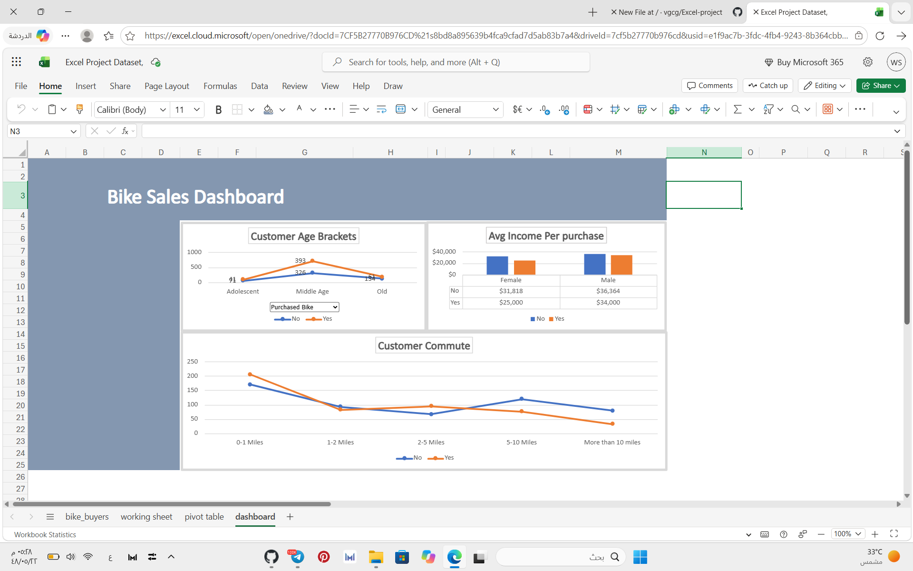

# 🚴 Bike Sales Analysis | Excel Dashboard

  <strong>Turning Raw Data into Actionable Business Insights</strong>

---

## 📌 Project Overview

This project focuses on analyzing bike sales data using Microsoft Excel to explore customer purchasing behavior and identify purchasing patterns.

The project transforms raw data into meaningful insights through data cleaning, PivotTables, PivotCharts, and an interactive dashboard.

## 🎯 Project Objectives

- Analyze customer demographics and purchasing behavior.
- Identify patterns among bike purchasers.
- Explore factors influencing purchasing decisions.
- Analyze the relationship between commute distance and bike purchases.
- Present insights through an interactive dashboard.

## 🛠️ Tools & Technologies

| Tool | Application |
|---|---|
| Microsoft Excel | Data Analysis |
| PivotTables | Data Summarization |
| PivotCharts | Data Visualization |
| Slicers | Interactive Filtering |
| Dashboard | Visual Reporting |

## 📊 Analysis Dimensions

- Gender
- Age
- Commute Distance
- Bike Purchase Status

## 📈 Dashboard Features

- Interactive data filtering.
- Customer demographic analysis.
- Bike purchase comparisons.
- Visual representation of purchasing patterns.
- Dynamic charts using PivotTables and PivotCharts.

## 🖼️ Dashboard Preview

## 📁 Project Structure
